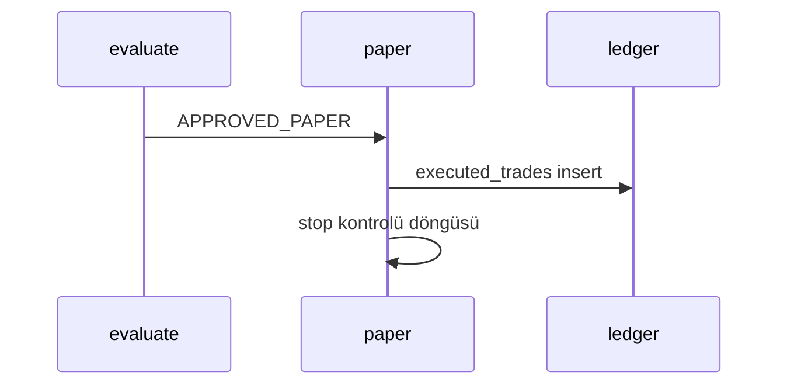

# Rol: PAPER icra ve pozisyon takibi

Yalnızca `APPROVED_PAPER` kararları simüle edilir. **LIVE yok.**

## Kapsam

- `src/golge_defter/paper.py`: açık pozisyon aç/kapa, stop-loss `%2.5` (`Constitution.stop_loss_fraction`)
- Giriş: `entry_ask`, çıkış kontrolü: güncel `bid` (architecture)
- Günlük gerçekleşmiş zarar sayacı UTC günü (basit: tarih string + toplam USDT)
- Ücret: sabit oran veya tek `fee_rate` parametresi; karmaşık tier yok

## Akış

## Yapma

- OKX emir API
- Kaldıraç, margin, futures

## Test

- Stop tetiklenmesi: bilinen bid/ask serisi ile deterministik test
- Günlük zarar limiti dolunca yeni BUY `SHADOW_RISK` (mevcut risk motoru; paper sayacı senkron)
- `pytest -q -n auto tests/test_paper.py tests/test_risk.py`

## Faz raporu

- Açık/kapalı pozisyon örneği
- Stop tetik log satırı (MOCK)
