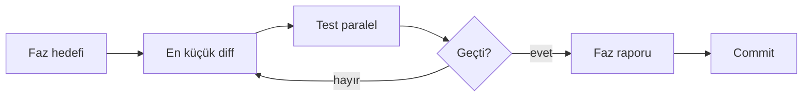

# Ortak agent kuralları

Hackathon tempo: **az kod, net test, her fazda rapor.**

## Prensipler

1. **Gereksiz mühendislik yok** — Önce `risk.py` ve mevcut tipleri kullan; yeni framework, DI katmanı veya "gelecek için" soyutlama ekleme.
2. **Fail-closed** — Veri yok/bayat/tutarsız → karar yok veya blok; sabit fiyatla işlem yok.
3. **Yetki sınırı** — Analist tutar ve emir üretmez. LIVE emir bu repoda varsayılan olarak **yasak**.
4. **Decimal para** — USDT ve oranlar `Decimal`; float yok.
5. **MOCK etiketi** — Simülasyon çıktıları `[MOCK / SIMULATED]` veya eşdeğeri ile işaretlenir.

## Çalışma döngüsü (her görev)

1. `docs/roadmap.md` içinde **tek** madde seç (faz kapsamı dar tutulur).
2. Değişiklik yap; yalnızca o maddeye hizmet eden dosyalara dokun.
3. Testleri **eş zamanlı** çalıştır (mümkünse):
   - `pytest -q -n auto` (kurulu değilse `pip install pytest-xdist` veya sadece `pytest -q`)
   - Aynı terminal oturumunda `python -m golge_defter.demo` (smoke)
4. Faz raporunu `docs/reports/YYYY-MM-DD-faz-N-kisa-aciklama.md` olarak yaz.
5. Anlamlı commit mesajı (Türkçe veya İngilizce, tek cümle neden).

## Paralel çalışma (swarm)

- Aynı fazda **farklı dosya/rol** paylaşımı: bir ajan test yazarken diğeri implementasyon (çakışmayan modüller).
- Aynı dosyada iki ajan **çalışmaz**; orkestratör sıraya alır.
- Her ajan bitince kendi rapor bölümünü şablona ekler; orkestratör birleştirir.

## Yasaklar

- API secret, `.env` içeriği, gerçek anahtar commit
- `Withdraw` veya LIVE emir kodu (ayrı onaylı faz olmadan)
- Anayasa kurallarını gevşetme (yalnızca sıkılaştırma)
- Büyük refactor "temizlik" adına

## Kaynak gerçekleri

| Modül | Dosya |
| --- | --- |
| Anayasa motoru | `src/golge_defter/risk.py` |
| Smoke demo | `src/golge_defter/demo.py` |
| Testler | `tests/` |

Karar durumları: `APPROVED_PAPER`, `SHADOW_RISK`, `SHADOW_PASS`, `TECHNICAL_BLOCK`, `NO_DECISION` — yeni durum eklemeden önce mimari belgede gerekçe yaz.
